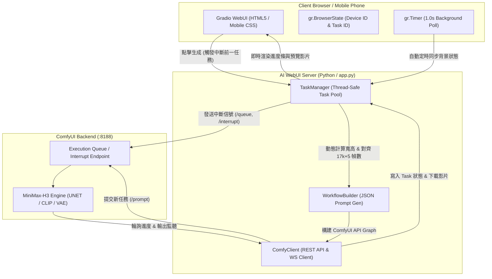

# MiniMax-H3 AI Video Generation Gradio WebUI

專為 **MiniMax-H3** 全模態音視訊聯合生成模型量身打造的高效、輕量化 Gradio 前端網頁。系統透過 REST API 解耦架構對接 ComfyUI 後端，支援電腦本機與手機跨裝置無縫連線，徹底擺脫在行動端操作 ComfyUI 龐雜節點畫布的痛點。

---

## 📑 目錄

- [✨ 核心功能特色](#-核心功能特色)
- [🏗️ 系統架構與關鍵機制](#️-系統架構與關鍵機制)
  - [1. 任務搶佔與即時中斷機制 (Task Preemption)](#1-任務搶佔與即時中斷機制-task-preemption)
  - [2. 斷線重連與背景自動同步 (Session Auto-Sync)](#2-斷線重連與背景自動同步-session-auto-sync)
  - [3. 嚴格裝置隔離與工作階段保存 (Multi-Device Isolation)](#3-嚴格裝置隔離與工作階段保存-multi-device-isolation)
  - [4. 解析度與畫質動態對齊演算 (Dimension Alignment)](#4-解析度與畫質動態對齊演算-dimension-alignment)
  - [5. 幀數對齊定律 (MiniMax 17k + 5 Rule)](#5-幀數對齊定律-minimax-17k--5-rule)
- [🎬 三大生成工作流](#-三大生成工作流)
- [📂 專案檔案結構](#-專案檔案結構)
- [📐 參數規範與計算公式](#-參數規範與計算公式)
- [🚀 快速啟動指南](#-快速啟動指南)
- [🔧 伺服器維護與更新旗標 (Server Maintenance Mode)](#-伺服器維護與更新旗標-server-maintenance-mode)
- [📱 手機行動端連線說明](#-手機行動端連線說明)
- [🧪 自動化測試與品質保證](#-自動化測試與品質保證)

---

## ✨ 核心功能特色

1. **三大生成模式一體化**：
   * **🖼️ 圖生影片 (I2V / `fl2va`)**：支援首幀（必填）與尾幀（選填），模型自動推演中間連續運鏡與平滑過渡。
   * **✍️ 文生影片 (T2V / `t2va`)**：純文字提示詞驅動高畫質動態畫面與自帶立體聲影片生成。
   * **🎬 參照生影片 (R2V / `ref2va`)**：支援最多 4 張參考圖片、1 段動作參考影片與參考音訊，提示詞支援 `<Picture 1>`、`<Video 1>` 精準實體錨定。
2. **任務即點即做（零排隊浪費）**：
   * 再次點擊「生成影片」時，系統立即中斷當前裝置正在運算的舊任務與 ComfyUI 佇列，直接提交並執行最新指令，無須手動終止後台進程。
3. **重連自動恢復（免手動重整）**：
   * 使用者在生成期間即便切換 App、熄螢幕或重新開啟瀏覽器，系統自動透過 Device ID 找回會話，背景生成完畢自動更新進度與預覽影片。
4. **直覺化畫質與尺寸運算（防呆無錯）**：
   * 介面全面移除容易誤填的寬高文字框，完全由「長寬比」與「品質檔次（Megapixels）」唯一數學映射，並強制對齊 16 像素倍數，杜絕比例畸變。
5. **行動端原生友善 (Mobile First)**：
   * 大尺寸拇指操作按鈕、滑動標籤頁、自動辨識區網 IP 顯示手機掃碼連線資訊。

---

## 🏗️ 系統架構與關鍵機制



### 1. 任務搶佔與即時中斷機制 (Task Preemption)
- **觸發時機**：當使用者在影片尚未生成完畢前，調整參數並再次點擊「生成影片」按鈕。
- **後端處置**：
  1. `task_manager.interrupt_device_tasks(device_id)`：向該裝置的背景監控執行緒發出 `cancel_event.set()`，停止後續輪詢。
  2. `comfy_client.interrupt_execution(prompt_id)`：向 ComfyUI 發送 API 請求：
     - `POST /queue`：從 `queue_running` 與 `queue_pending` 刪除指定任務。
     - `POST /api/jobs/{prompt_id}/cancel`：取消特定任務 Job。
     - `POST /interrupt`：強制中斷當前 GPU 核心上的取樣運算。
  3. `Task` 狀態即時標記為 `"interrupted"`。
- **無縫接續**：舊任務中斷完成後，前端立即上傳最新素材並提交新工作流至 ComfyUI，實現「最新點擊優先執行」。

### 2. 斷線重連與背景自動同步 (Session Auto-Sync)
- 任務開始時，工作階段將任務識別碼寫入客戶端 `session_task_state` (`gr.BrowserState`)。
- 若使用者關閉瀏覽器或切換應用程式，伺服器背景執行緒仍持續監控並下載產出影片至 `outputs/` 目錄。
- 當使用者重新開啟網頁時：
  - `demo.load` 觸發 `restore_device_state`，恢復先前的參數與最後產出的影片。
  - 前端掛載之 `task_poll_timer`（每 1 秒觸發一次）自動調用 `poll_active_task_progress` 檢查進行中任務。
  - 任務一旦於背景完成，進度面板立即自動推播 100% 完成狀態，並將影片載入播放器中，**全程無須使用者手動點擊恢復或重新整理頁面**。

### 3. 嚴格裝置隔離與工作階段保存 (Multi-Device Isolation)
- 透過 `gr.BrowserState` 保存加密的 `minimax_device_id`（預設隨機產生 6 位數短 ID，例如 `71c8f5`）。
- 每個裝置的所有任務記錄、參數快照與歷程影片獨立歸屬於該 `device_id`。
- 「歷史生成紀錄」選單經過嚴格權限過濾，A 裝置絕對無法檢視或下載 B 裝置生成的影片。
- 支援「✏️ 手動切換裝置 ID」功能，更換手機或清除 Cookie 時，只需輸入舊的 6 位數 ID 即可瞬間找回所有歷程。

### 4. 解析度與畫質動態對齊演算 (Dimension Alignment)
- 前端徹底移除 `custom_w` 與 `custom_h` 輸入框，避免使用者輸入不支援的尺寸或非整數倍數導致報錯。
- **合法輸出影片解析度標準**：
  1. **空間倍數對齊**：MiniMax-H3 的 Spatial VAE compression 為 16x，DiT 空間 Patch 為 2x2（官方節點規範 `CANVAS_MULTIPLE = 32`, `step=32, min=32`），影片編碼同樣要求能被 16 或 32 整除。因此，寬高必須同時為 **32 的整數倍**。
  2. **總像素面積**：緊密貼合所選畫質檔次：$\text{area} = \text{Megapixels} \times 10^6$（基準畫質約 1.03 MP，單幀建議範圍 0.2 MP ~ 2.0 MP，短邊 $\ge 256$，長邊 $\le 2048$）。
  3. **首幀零畸變**：因 ComfyUI `MiniMaxH3ImageToVideo` 節點以 `"disabled"` 裁切直接無襯墊拉伸首幀，長寬比必須極致對齊原圖。
- **自適應原圖比例網格搜尋演算法 (Adaptive AR Grid-Search)**：
  - I2V 與 R2V 預設選用 **「原圖比例 (自動對齊)」**。
  - 上傳圖片時，系統讀取原圖真實尺寸 $(W_{orig}, H_{orig})$ 計算真實比例 $r = W_{orig} / H_{orig}$，並在目標面積 $\pm 18\%$ 範圍內的 32 倍數微調網格中搜尋：
    $$\text{Score} = 100 \times \frac{|\frac{W}{H} - r|}{r} + \frac{|\text{Area} - \text{Target Area}|}{\text{Target Area}}$$
  - 挑選出 $\text{Score}$ 最小的最優整數 $(W, H)$，使拉伸誤差低於 0.3%（甚至 0.00%，例如 1500x1000 輸出 1248x832），同時滿足 32 像素硬體編碼標準。
  - 使用者亦可隨時切換至固定標準比例（16:9, 9:16, 1:1, 4:3, 3:4, 21:9）。

### 5. 幀數對齊定律 (MiniMax 17k + 5 Rule)
MiniMax-H3 的時空潛空間 (Temporal Latent) 遵循嚴格的步進公式：
$$F = 17k + 5 \quad (k \in \mathbb{N}, k \ge 1)$$
系統會根據使用者設定的秒數（預設 24 FPS）自動四捨五入吸附至最接近的有效幀數（例如 5.0 秒 $\approx 120$ 幀，自動吸附至 $k=7$ 的 $124$ 幀），確保 VAE 解碼時不發生時序維度不合的崩潰。

---

## 🎬 三大生成工作流

| 模式名稱 | 工作流代號 | 核心輸入節點 | 適用情境與特色 |
| :--- | :--- | :--- | :--- |
| **圖生影片** | `I2V` (`fl2va`) | `LoadImage` (首幀), `LoadImage` (可選尾幀) | 靜態插畫動態化、首尾分鏡過渡平滑演繹 |
| **文生影片** | `T2V` (`t2va`) | `CLIPTextEncodeMiniMax` (正負提示詞) | 概念發想、純文字分鏡直接驅動音視訊 |
| **參照生影片** | `R2V` (`ref2va`) | `LoadImage` (1~4張), `VHS_LoadVideo`, `LoadAudio` | 角色固定外貌演繹、動作捕捉遷移、音訊對嘴同步 |

---

## 📂 專案檔案結構

```text
F:\program_file\AI_webUI\
├── app.py                  # Gradio WebUI 主程式（介面佈局、事件綁定、狀態恢復、Timer 輪詢）
├── config.py               # 核心常數配置（預設模型、長寬比預設值、17k+5 與 16 像素對齊演算法）
├── comfy_client.py         # ComfyUI API 客戶端（REST 呼叫、任務佇列、任務中斷、檔案上傳/下載）
├── workflow_builder.py     # MiniMax-H3 工作流 JSON 節點圖構建器（I2V, T2V, R2V）
├── task_manager.py         # 執行緒安全之任務管理器（多裝置隔離、背景輪詢、取消事件、歷史記錄持久化）
├── logger.py               # 終端機彩色格式化日誌模組
├── run.bat                 # Windows 一鍵啟動 WebUI 批次檔 (Port 7860)
├── run_dev.bat             # 開發熱重載啟動批次檔 (支援代碼變更即時重新加載)
├── run_tests.bat           # 全自動測試套件執行腳本 (Unit Tests + E2E Tests)
├── test_e2e.py             # 模擬使用者真實操作情境的端到端整合測試套件
├── spec.md                 # 專案需求與功能詳細規格文件
├── requirements.txt        # 專案 Python 相依套件列表
├── outputs/                # 生成影片下載目錄與 task_history.json 本地保存庫
└── tests/                  # 現代化單元測試目錄 (100% 覆蓋核心邏輯)
    ├── test_app_state.py        # 測試 UI 初始化、工作階段恢復、定時輪詢、中斷觸發
    ├── test_comfy_client.py     # 測試伺服器探針、上傳、下載、佇列中斷邏輯
    ├── test_config.py           # 測試 17k+5 幀數吸附、16 像素對齊、品質檔次正規化
    ├── test_logger.py           # 測試日誌輸出與格式器
    ├── test_task_manager.py     # 測試多裝置任務隔離、背景執行緒生命週期與中斷
    └── test_workflow_builder.py # 測試 I2V, T2V, R2V 工作流節點拓撲正確性
```

---

## 📐 參數規範與計算公式

### 1. 畫質檔次與百萬像素 (Megapixels)

| 檔次標籤 | 百萬像素 (MP) | 16:9 解析度範例 | 適用場合 |
| :---: | :---: | :---: | :--- |
| `1 (0.2 MP - 測試預覽)` | 0.2 MP | $592 \times 336$ | 最快生成、構圖預覽、除錯測試 |
| `2 (0.4 MP - 快速生成)` | 0.4 MP | $848 \times 480$ | 快速出片、日常靈感探索 |
| `3 (0.6 MP - 輕量均衡)` | 0.6 MP | $1040 \times 576$ | 手機觀看、兼顧畫質與運算耗時 |
| `4 (0.8 MP - 高畫質)` | 0.8 MP | $1200 \times 672$ | 社群媒體高畫質短影音 |
| `5 (1.0 MP - 標準推薦)` | 1.0 MP | $1344 \times 752$ | 官方推薦基準畫質、細節豐富 |
| `6 (1.5 MP - 超清旗艦)` | 1.5 MP | $1632 \times 928$ | 大螢幕展示、極致紋理與光影表現 |

### 2. 支援之標準長寬比 (Aspect Ratios)
- `16:9 (橫向風景)`
- `9:16 (直向短影音)`
- `1:1 (正方形頭像)`
- `4:3 (標準電視螢幕)`
- `3:4 (直向構圖)`
- `21:9 (電影寬螢幕)`

---

## 🚀 快速啟動指南

### 1. 啟動 WebUI
雙擊執行專案目錄下的 `run.bat`：
```cmd
F:\program_file\AI_webUI\run.bat
```
啟動後終端機會印出本機與行動裝置連線資訊：
```text
============================================================
MiniMax-H3 Gradio WebUI Starting (Port: 7860)...
Local Access: http://127.0.0.1:7860
Mobile LAN Access: http://192.168.1.100:7860
ComfyUI Backend: http://127.0.0.1:8188
============================================================
```

### 2. 啟動 ComfyUI 後端
WebUI 首頁工具列內建後端管理器：
- **檢查與啟動**：若 ComfyUI 尚未啟動，點擊頂部 **「⚡ 檢查後端模型狀態...」** 按鈕，系統將自動啟動 ComfyUI 背景服務並掛載模型庫。
- **終止後端**：點擊 **「🛑」** 按鈕可一鍵釋放後端 GPU 記憶體並優雅關閉進程。

---

## 🔧 伺服器維護與更新旗標 (Server Maintenance Mode)

系統內建全域維護狀態控制旗標，讓管理者在進行模型庫更新、代碼部署或除錯時，可隨時將 WebUI 切換至維護模式，防止使用者在維護期間發送生成任務：

### 1. 啟用維護模式 (UPDATING)
- **方式 A（修改配置檔）**：
  在 `config.py` 中將旗標修改為：
  ```python
  SERVER_STATUS = SERVER_STATUS_UPDATING
  ```
- **方式 B（環境變數啟動）**：
  在啟動 WebUI 前設定環境變數：
  ```cmd
  set SERVER_STATUS=UPDATING
  run.bat
  ```
- **方式 C（Python 程式調用）**：
  ```python
  from config import set_server_status, SERVER_STATUS_UPDATING
  set_server_status(SERVER_STATUS_UPDATING)
  ```

### 2. 維護模式下的系統行為
- **醒目警示橫幅**：WebUI 頁面頂部以紅色背景高亮顯示 `🔧 伺服器維護/更新中`。
- **後端狀態同步**：狀態列即時顯示 `🔧 伺服器維護/更新中`，點擊啟動按鈕會安全攔截並提示 `⚠️ 伺服器維護/更新中，暫停啟動後端`。
- **安全防護機制**：I2V、T2V、R2V 生成按鈕會主動阻斷任務提交，並顯示 `⚠️ 伺服器維護/更新中，暫停提交生成任務`，防止在維護中產生損毀任務。

### 3. 解除維護模式恢復服務 (OK)
維護與更新作業完成後，將旗標改回 `SERVER_STATUS_OK`（或移除環境變數）即可瞬間恢復所有功能：
```python
from config import set_server_status, SERVER_STATUS_OK
set_server_status(SERVER_STATUS_OK)
```

---

## 📱 手機行動端連線說明

1. **同網域 Wi-Fi**：請確保手機與運行 WebUI 的電腦連線至相同的 Wi-Fi 路由器。
2. **網址前綴**：手機瀏覽器網址列請務必輸入 `http://`，例如：
   ```text
   http://192.168.1.100:7860
   ```
   > ⚠️ 請勿輸入 `https://`，以免因無 SSL 憑證導致連線失敗。
3. **防火牆連接埠放行**：若手機無法開啟網頁，請至 Windows Defender 防火牆新增「輸入規則」，放行 TCP 連接埠 `7860`。

---

## 🧪 自動化測試與品質保證

專案具備健全的測試體系，涵蓋 67 項單元測試與 8 大階段真實使用者端到端 (E2E) 測試。

### 一鍵執行所有測試
雙擊執行專案根目錄下的 `run_tests.bat`：
```cmd
F:\program_file\AI_webUI\run_tests.bat
```

### 1. 單元測試 (pytest)
```cmd
pytest tests/ -v
```
測試內容涵蓋：
- `test_app_state.py`：驗證多裝置會話恢復、背景輪詢定時器、中斷任務事件、移除自訂尺寸防呆機制。
- `test_comfy_client.py`：驗證 ComfyUI 探針、佇列中斷 API、素材上傳、影片二進位串流下載。
- `test_config.py`：驗證 $17k + 5$ 幀數換算定律、16 像素對齊、百萬像素解析度換算。
- `test_task_manager.py`：驗證嚴格裝置隔離、執行緒安全佇列、工作階段持久化。
- `test_workflow_builder.py`：驗證 I2V, T2V, R2V 工作流 JSON 節點拓撲正確性。

### 2. 端到端整合測試 (E2E)
```cmd
python test_e2e.py
```
在不依賴外部即時 GPU 運算的情況下，透過高仿真 In-Process Mock 伺服器驗證完整生命週期：
1. 後端探針連線驗證
2. 前端 WebUI 啟動與 HTTP 200 健康檢查
3. 舊版工作階段參數自動相容升級
4. 即時提交生成任務與 SSE / 串流進度推播
5. MP4 檔案二進位 Magic Header 完整性校驗
6. 歷史畫廊檢索與嚴格多裝置跨權限防洩漏驗證
7. WebUI 與後端進程之優雅終止釋放
