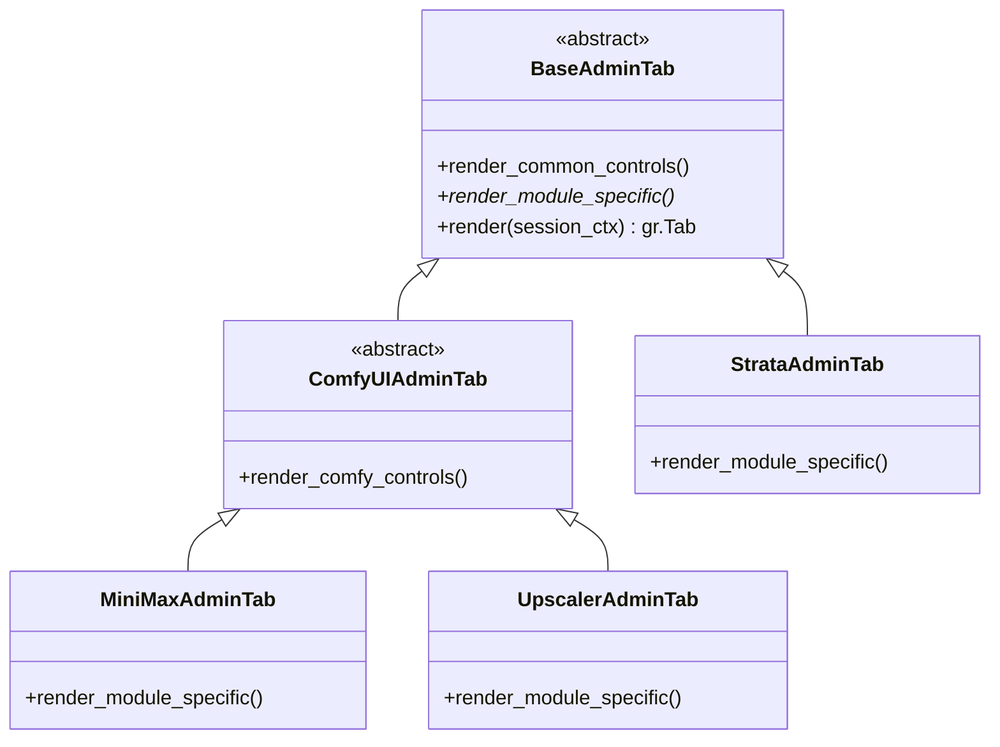

# 使用手冊與規範
## 伺服器維護旗標 (`SERVER_STATUS`)，**每次開始更動程式碼前要改**
- **目的**：
  - 當管理者或開發者需要對伺服器進行更新、模型替換或代碼維護時，可平滑將 WebUI 切換至維護模式，防止使用者在維護期間發送生成請求導致任務異常或損壞。
- **旗標定義與介面 (`config.py`)**：
  - 常數：`SERVER_STATUS_OK = "OK"`, `SERVER_STATUS_UPDATING = "UPDATING"`
  - 全域變數：`SERVER_STATUS`（預設為 `SERVER_STATUS_OK`）
  - 介面函式：`get_server_status() -> str`、`set_server_status(status: str) -> None`
- **使用方式**：
  1. **代碼/配置檔設定**：
     - 在修改代碼前，於 `config.py` 將 `SERVER_STATUS = SERVER_STATUS_UPDATING`。
     - 或在 Python 腳本/控制台中執行：`from config import set_server_status, SERVER_STATUS_UPDATING; set_server_status(SERVER_STATUS_UPDATING)`。
  2. **環境變數設定**：
     - 在啟動伺服器前於終端設定：`set SERVER_STATUS=UPDATING`（Windows）或 `export SERVER_STATUS=UPDATING`（Linux）。
  3. **維護完成後恢復**：
     - 將 `config.py` 改回 `SERVER_STATUS = SERVER_STATUS_OK`，或調用 `set_server_status(SERVER_STATUS_OK)`，或取消環境變數。
## 注意事項
- 應避免UI介面出現過多開發相關字詞，讓使用者只看到他需要看到的東西

---

# 接下來要執行的任務與詳細規劃：

## 1. 架構重組目標與核心原則 (OOP & Modular Architecture)
- **現狀問題**：原 `app.py` 高達 2444 行，將所有 UI 元件構建、樣式、業務邏輯、事件回呼、狀態恢復、管理員功能與後端進程混雜於單一檔案中。I2V、T2V、R2V 介面出現大量重複的參數輸入與視訊播放卡片，狀態恢復透過硬編碼 49 個元素的巨型元組傳遞，極度臃腫且擴展困難。
- **重構原則**：
  1. **DRY (Don't Repeat Yourself)**：能不重複寫的代碼絕不重複寫。共用參數卡片、播放器、進度條、工具列等全面抽離為獨立元件。
  2. **物件導向設計 (OOP & Abstraction)**：透過抽象基類 (`BaseView`) 與 ComfyUI 專用基類 (`ComfyUIBaseView`)，確立所有功能視圖的統一生命週期（`render`, `register_events`, `restore_state`, `poll_progress`）。
  3. **職責分離 (Separation of Concerns)**：`app.py` 僅作整體裝配與進入點；UI 元件歸入 `components/`；核心功能視圖歸入 `views/`；底層通用抽象與管理器歸入 `core/`。
  4. **嚴格向前相容 (Backward Compatibility)**：保留現有裝置隔離機制、狀態還原流程及既有測試介面。

---

## 2. 系統目錄結構詳細規劃
重構後的專案目錄結構如下：
```text
F:\program_file\AI_webUI\
├── app.py                         # 系統進入點 (Slim Entry Point，負責裝配與伺服器啟動)
├── config.py                      # 全域設定常數、解析度計算與維護旗標
├── comfy_client.py                # ComfyUI API 通訊、WebSocket 進度與進程管理
├── task_manager.py                # 裝置隔離任務佇列與儲存管理器
├── logger.py                      # 統一 Logging 管理器
├── core/                          # 核心抽象與系統管理
│   ├── __init__.py
│   ├── base_view.py               # 抽象視圖基類 BaseView (定義生命週期與介面契約)
│   ├── comfy_view.py              # ComfyUI 系列視圖基類 ComfyUIBaseView (繼承 BaseView)
│   ├── session_context.py         # 裝置 Session 與狀態管理器 (封裝裝置 ID 與還原邏輯)
│   ├── admin_manager.py           # 管理員權限、自訂 IP 名單與伺服器狀態維護
│   └── port_guardian.py           # 通訊埠 7860 佔用檢測與排查診斷工具
├── components/                    # 可重複使用的模組化網頁元件
│   ├── __init__.py
│   ├── styles.py                  # 全域 CSS 與客戶端 JavaScript 腳本
│   ├── header.py                  # 頂部導航橫幅 HeaderComponent (IP、ID 徽章、維護警示)
│   ├── dashboard_sidebar.py       # 左上方展開式 Dashboard 導航選單 (切換 3 大核心模組)
│   ├── comfy_toolbar.py           # ComfyUI 後端模型狀態與啟停工具列 (ComfyToolbarComponent)
│   ├── video_params.py            # 視訊生成共用參數卡片 (VideoParamsComponent: 時長/步數/FPS/種子/去噪/取樣)
│   ├── media_player.py            # 進度條 + 影片播放器 + 恢復按鈕 (VideoPlayerCardComponent)
│   └── history_gallery.py         # 歷史紀錄檢視器元件 (HistoryGalleryComponent)
├── views/                         # 三大核心功能視圖與管理面板
│   ├── __init__.py
│   ├── minimax/                   # 模組 1: MiniMax-H3 影片生成
│   │   ├── __init__.py
│   │   ├── view.py                # MiniMaxView (繼承 ComfyUIBaseView)
│   │   └── tabs/                  # I2V, T2V, R2V 子頁面
│   │       ├── __init__.py
│   │       ├── i2v_tab.py         # 圖生影片子頁面
│   │       ├── t2v_tab.py         # 文生影片子頁面
│   │       └── r2v_tab.py         # 參考生影片子頁面
│   ├── upscaler/                  # 模組 2: 影片超解析度放大 (Video Resolution Upscaler)
│   │   ├── __init__.py
│   │   └── view.py                # UpscalerView (繼承 ComfyUIBaseView，預留並具備基本 UI)
│   ├── strata/                    # 模組 3: Strata LLM (Qwen3.8-flash-next)
│   │   ├── __init__.py
│   │   └── view.py                # StrataView (繼承 BaseView，文字問答/助手介面)
│   └── admin/                     # 管理員專區
│       ├── __init__.py
│       └── view.py                # AdminPanelView (繼承 BaseView)
├── workflow_builder.py            # MiniMax 工作流產生器
├── tests/                         # 單元測試集
├── run.bat                        # 主要啟動腳本
└── run_tests.bat                  # 測試執行腳本
```

---

## 3. 左側 Dashboard 設計與導航機制 (gr.Sidebar)
- **位置與形式**：
  - 於頁面左側採用 Gradio 原生 `gr.Sidebar` 實現抽屜式導航欄，支援平滑展開與收合（避免使用傳統下拉選單 `gr.Dropdown` 或頂部摺疊面板）。
  - 展開後提供三大核心項目之快速切換：
    1. 🎬 `comfyUI: minimax video generator` (MiniMax-H3 影片生成系統)
    2. 🔍 `comfyUI: video resolution upscaler` (影片解析度放大增強系統)
    3. 💬 `strata: Qwen3.8-flash-next LLM` (Strata 語言模型智慧工作台)
- **聯動機制**：
  - 各模組封裝於獨立的 `gr.Column` 容器中。
  - 透過 `gr.Radio` 與快捷按鈕觸發狀態切換，完全杜絕下拉選單遮擋問題；點擊 Dashboard 項目時切換各容器的 `visible=True/False`，達到瞬間流暢切換且互不干擾的效果。

---

## 4. 物件導向視圖架構 (OOP Hierarchy)
- **`BaseView(ABC)`**：
  - `render(session_ctx: SessionContext) -> gr.Column`：建構並返回該視圖的 Gradio UI 佈局。
  - `register_events(session_ctx: SessionContext) -> None`：綁定視圖元件的所有事件處理。
  - `get_restore_components() -> List[Any]`：返回該視圖需參與狀態還原之元件清單。
  - `restore_state(task: Optional[Task], device_id: str) -> List[Any]`：產生此視圖在頁面重整時的更新清單。
  - `poll_progress(task: Optional[Task], device_id: str) -> List[Any]`：產生此視圖在背景任務更新時的進度更新。
- **`ComfyUIBaseView(BaseView)`**：
  - 繼承 `BaseView`，共用 ComfyUI 後端狀態工具列與伺服器健康度檢查。
  - 封裝維護模式阻斷機制 (`SERVER_STATUS_UPDATING` 偵測與友善提示)。
  - 封裝通用 ComfyUI 工作流提交、輪詢與中斷協調。
- **具體實作類別**：
  - `MiniMaxView(ComfyUIBaseView)`：整合 I2V、T2V、R2V 分頁、歷史檢視與各生成處理函式。
  - `UpscalerView(ComfyUIBaseView)`：影片上傳、放大倍率 (2x/4x)、模型選擇、畫質增強之視圖封裝。
  - `StrataView(BaseView)`：Strata / Qwen3.8 聊天視窗、Prompt 系統設定、上下文管理。
  - `AdminPanelView(BaseView)`：伺服器狀態切換、顯存清理、佇列監控、全域任務管理與管理員 IP 白名單。

---

## 5. 模組化網頁元件 (DRY Components)
- **`VideoParamsComponent`**：
  - 統一封裝：長寬比、畫質等級、影片時長、取樣步數、影格率 (FPS)、隨機種子 (含隨機按鈕)、去噪強度、取樣器、調度器。
  - 一行代碼即可在 I2V / T2V / R2V 或 Upscaler 中複用，並提供統一的參數字典讀取與設定介面。
- **`VideoPlayerCardComponent`**：
  - 統一封裝：標準進度條 HTML (`build_progress_html`)、"恢復上次輸入與成果"按鈕、影片播放器 (`gr.Video`)。
- **`ComfyToolbarComponent`**：
  - 封裝後端連線檢查、啟動後端按鈕、停止按鈕及硬體資源預先檢查。
- **`HeaderComponent`**：
  - 封裝系統橫幅、內網 IP 標籤、簡潔 Device ID 徽章（含點擊複製與✏️手動修改按鈕）、維護中警示條。
- **`HistoryGalleryComponent`**：
  - 封裝歷史任務下拉選單、影片播放器、任務詳細資訊 Markdown 及刪除任務按鈕。

---

## 6. 施工步驟與驗證規劃 (Execution Checklist)
- [x] **Step 1: 伺服器狀態維護模式**
  - 依據規範，在 `config.py` 中將 `SERVER_STATUS = SERVER_STATUS_UPDATING`。
- [x] **Step 2: 建立 `components/` 模組**
  - 實作 `styles.py`、`header.py`、`dashboard_sidebar.py`、`comfy_toolbar.py`、`video_params.py`、`media_player.py`、`history_gallery.py`。
- [x] **Step 3: 建立 `core/` 系統架構模組**
  - 實作 `base_view.py`、`comfy_view.py`、`session_context.py`、`admin_manager.py`、`port_guardian.py`。
- [x] **Step 4: 建立 `views/` 核心視圖模組**
  - 實作 `views/minimax/view.py` (含 I2V, T2V, R2V 子分頁)。
  - 實作 `views/upscaler/view.py` (Upscaler 視圖基底)。
  - 實作 `views/strata/view.py` (Strata 視圖基底)。
  - 實作 `views/admin/view.py` (AdminPanelView)。
- [x] **Step 5: 重構 `app.py` 作為精簡進入點**
  - 裝配所有模組與全域事件，提供相容性導出介面 (`demo`, `restore_device_state`, `all_restored_outputs` 等)。
- [x] **Step 6: 驗證與測試**
  - 運行全套單元測試 (`tests/`)，確保所有既有功能與狀態隔離測試全數通過 (100% Green)。
- [x] **Step 7: 復原伺服器狀態旗標**
  - 將 `config.py` 改回 `SERVER_STATUS = SERVER_STATUS_OK`。

---

## 7. 階段二：管理員標籤階層化 (Tab-Level OOP) 與 IP 識別 Bug 修復

### 7.1 現象與問題剖析
1. **本機/已登錄 IP 無法看到管理員頁面**：
   - Windows 雙棧環境下，Uvicorn/FastAPI 將本機連線之 `request.client.host` 報告為 IPv4-mapped IPv6（例如 `::ffff:127.0.0.1` 或 `::ffff:192.168.x.x`）。
   - 舊版 `AdminManager.get_local_ip_set()` 僅比對 IPv4 字串 `127.0.0.1`，造成字串比對失敗而判定非超級使用者。
   - 原架構重構時，管理員標籤頁被孤立放置於 `gr.Blocks` 根目錄，脫離各視圖的 `gr.Tabs()` 容器，導致 Gradio 無法正常渲染標籤頁。
2. **管理員頁面層級定位與物件導向繼承**：
   - 管理員頁面應屬於各模組內部的 `gr.Tab`，而非獨立外部頁面。
   - 三個 View 既有共用模組（維護開關、硬體監控、裝置管理、ComfyUI 顯存清理等），亦有各視圖專屬介面（MiniMax 任務過濾、Upscaler Tile 快取、Strata API 金鑰）。需以物件導向繼承與封裝完整落實。

### 7.2 物件導向繼承架構設計


### 7.3 執行項目與驗證檢核 (Phase 2 Checklist)
- [x] **Step 1: IP 正規化與權限判定修復**
  - 於 `core/admin_manager.py` 實作 `normalize_ip()`，自動解析 `::ffff:` 前綴與 `is_loopback`。
- [x] **Step 2: 管理員 Tab 物件導向階層建立**
  - 實作 `core/base_admin_tab.py` (`BaseAdminTab`)。
  - 實作 `core/comfy_admin_tab.py` (`ComfyUIAdminTab`)。
  - 實作 `views/minimax/admin_tab.py` (`MiniMaxAdminTab`)。
  - 實作 `views/upscaler/admin_tab.py` (`UpscalerAdminTab`)。
  - 實作 `views/strata/admin_tab.py` (`StrataAdminTab`)。
- [x] **Step 3: 嵌入各 View 內部 Tabs**
  - 於 `MiniMaxView`、`UpscalerView`、`StrataView` 內部的 `gr.Tabs()` 掛載各自專屬的管理員 Tab。
  - 於 `app.py` 中實作 `update_all_admin_tabs_visibility`，同時控制三個模組的管理員 Tab 顯示/隱藏。
- [x] **Step 4: 單元測試與回歸驗證**
  - 新增 `tests/test_admin_tabs.py` (5 項測試)，驗證類別繼承、IP 正規化與組件生成。
  - 全套 87 項單元測試 100% 通過。
- [x] **Step 5: 功能落地狀態文件化**
  - 於 `README.md` 詳實記錄三大模組之已實作功能與待實作功能。
- [x] **Step 6: 伺服器狀態復原**
  - 將 `config.py` 改回 `SERVER_STATUS = SERVER_STATUS_OK`，並同步寫入 `.server_status`。

